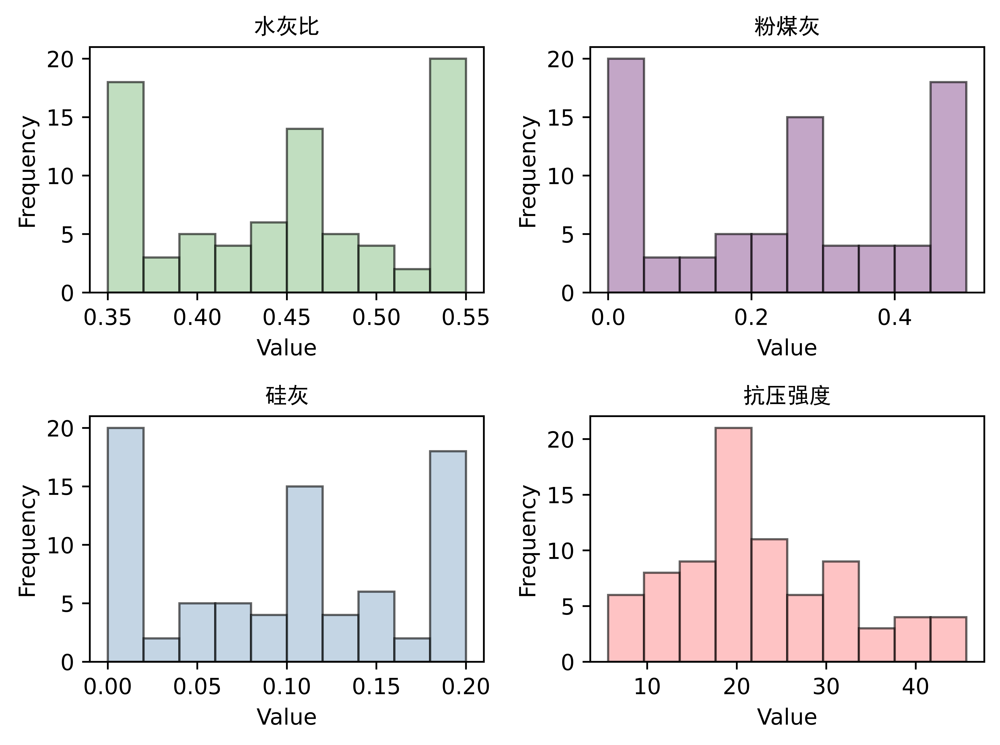
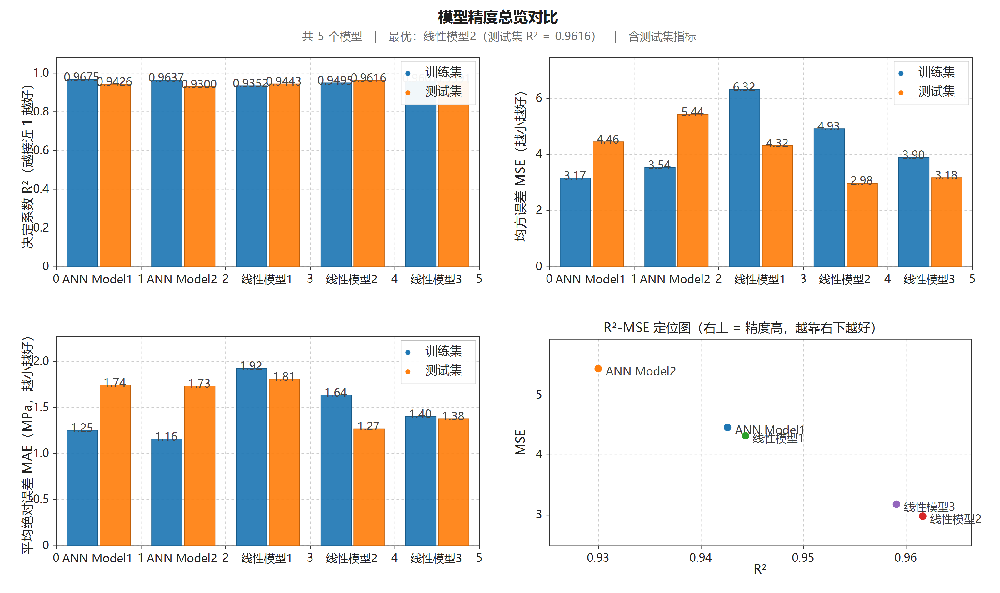
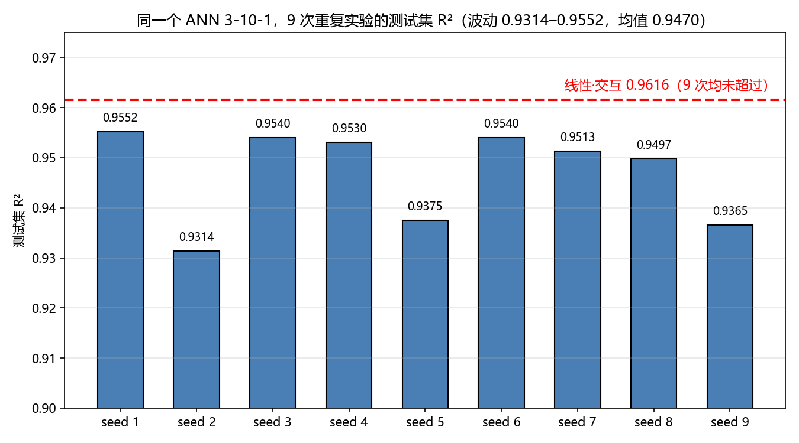
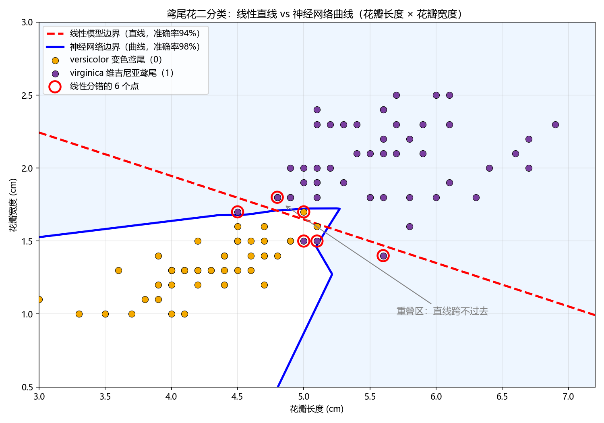

# 混凝土抗压强度预测 · Concrete Compressive Strength Prediction

**[中文](README_zh.md) | [English](README.md)**

基于**最小二乘线性回归**（3 种变体）与**手写反向传播神经网络**（2 种结构）的混凝土抗压强度预测课程设计。所有模型均使用**纯 NumPy 矩阵运算从零实现**，不依赖 scikit-learn、TensorFlow、PyTorch 等任何机器学习框架。

> **同一套研究的两种实现**：下文的 NumPy 版，以及把整条链路搬到结构设计平台上的**低代码 E-GAMA 卡片版**
> （同一份 66/16 数据、同一种算法，另有第二个非线性案例「鸢尾花分类」）——
> 见 [`gama-cards/`](gama-cards/README_zh.md)。

[](https://www.python.org/)
[](https://numpy.org/)
[](LICENSE)

---

## 📌 项目简介

| 项目 | 说明 |
|------|------|
| **任务** | 预测混凝土 **28 天抗压强度**（MPa） |
| **输入特征** | 水灰比、粉煤灰、硅灰 |
| **目标变量** | 抗压强度 |
| **样本量** | 81 组有效数据 → 构造缺失后 82 组 |
| **数据划分** | 66 训练 / 16 测试（约 8:2，随机种子 42） |
| **模型** | 3 种最小二乘线性模型 + 2 种手写 ANN |
| **评价指标** | R²、MSE、MAE |

**⭐ 核心结论**：单隐藏层 ANN（**Model1**）取得最优测试集表现——**R² = 0.9654，MSE = 2.6859，训练仅 0.28 秒**，优于最优线性模型（R² = 0.9616）。ANN 的非线性拟合能力更能捕捉混凝土配合比与强度之间的复杂关联。

---

## 📊 数据集

原始数据（`data/data.xlsx`）包含 **81 组混凝土配合比样本**，4 个 float64 变量，无初始缺失值。

| 变量 | 均值 | 标准差 | 取值范围 | 偏度 | 分布类型 |
|------|------|--------|----------|------|----------|
| 水灰比 | 0.4506 | 0.0725 | 0.35 ~ 0.55 | −0.0069 | 正态分布 |
| 粉煤灰 | 0.2471 | 0.1830 | 0.00 ~ 0.50 | 0.0099 | 正态分布 |
| 硅灰 | 0.0982 | 0.0726 | 0.00 ~ 0.20 | 0.0163 | 正态分布 |
| 抗压强度 (MPa) | 22.6027 | 9.8035 | 5.63 ~ 45.66 | 0.4586 | 右偏分布 |

<p align="center">
  
  <br><em>图 1 —— 四个变量的分布直方图（水灰比、粉煤灰、硅灰、抗压强度）</em>
</p>

---

## 🧹 数据预处理（`src/preprocess.py`）

预处理流程包含四个核心步骤：

### 1. 数据加载与探索性分析
通过 `pandas.read_excel()` 加载 `data.xlsx`，使用 `head()` / `describe()` / `info()` 初步查看数据质量与统计特征。

### 2. 缺失值构造与插补
在数据集末尾添加一行全缺失样本（`df.loc[81] = np.nan`）模拟缺失场景，然后**依据分布类型针对性插补**：

| 变量 | 偏度 | 插补策略 | 填充值 |
|------|------|----------|--------|
| 水灰比 | −0.0069 | **均值插补**（正态） | 0.4506 |
| 粉煤灰 | 0.0099 | **均值插补**（正态） | 0.2471 |
| 硅灰 | 0.0163 | **均值插补**（正态） | 0.0982 |
| 抗压强度 | 0.4586 | **中位数插补**（偏态） | 20.8840 |

### 3. Z-Score 标准化
仅对 3 个输入特征标准化（`z = (x − μ) / σ`，均值趋近 0、标准差趋近 1），消除量纲差异；目标变量保持原始值。

### 4. 数据集划分
`np.random.seed(42)` 固定随机种子 → 打乱索引 → 前 16 条为测试集、其余 66 条为训练集，分别保存至 `data/test.xlsx` 与 `data/train.xlsx`。

---

## 🧠 模型构建

### 1. 最小二乘线性模型（`src/linear_model.py`）

基于**正规方程** β = (XᵀX)⁻¹XᵀY 矩阵求解，从底层数学原理手写实现：

| 模型 | 公式 | 参数个数 |
|------|------|----------|
| **模型 1** —— 简单线性 | y = a + b·x₁ + c·x₂ + d·x₃ | 4 |
| **模型 2** —— 特征交互 | 模型1 + e·x₁x₂ + f·x₁x₃ + g·x₂x₃ | 7 |
| **模型 3** —— 多项式 | 模型2 + h·x₁² + i·x₂² + k·x₃² | 10 |

其中 x₁ = 水灰比、x₂ = 粉煤灰、x₃ = 硅灰、y = 抗压强度。

<p align="center">
  
  
  
  <br><em>图 2-4 —— 三种线性模型「真实值-预测值」散点图（左训练集 / 右测试集）</em>
</p>

### 2. ANN 神经网络模型（`src/ANN_model.py`）

手写实现 **前向传播 → 反向传播 → 梯度下降** 完整流程，关键设计：

- **He 初始化**：`std = √(2/n_in)`，避免梯度消失/爆炸
- **Leaky ReLU**（α = 0.01）：解决神经元死亡问题（普通 ReLU 下模型 2 无法有效预测）
- **恒等激活输出层**：适配回归任务
- 梯度下降，学习率 1×10⁻⁴，**训练 10000 轮**，MSE 损失

| 模型 | 网络结构 | 参数个数 |
|------|----------|----------|
| **ANN 模型 1** —— 单隐藏层 | 3 → 10 → 1 | 51 |
| **ANN 模型 2** —— 双隐藏层 | 3 → 5 → 5 → 1 | 56 |

<p align="center">
  
  
  <br><em>图 5-6 —— 两种 ANN 模型「真实值-预测值」散点图</em>
</p>

<p align="center">
  
  
  <br><em>图 7-8 —— 10000 轮训练的 MSE 收敛曲线（模型 2 存在局部波动但最终收敛）</em>
</p>

---

## 📈 实验结果

### 最小二乘线性模型

| 模型 | 训练集 R² | 测试集 R² | 训练集 MSE | 测试集 MSE | 训练集 MAE | 测试集 MAE |
|------|-----------|-----------|------------|------------|------------|------------|
| 模型1（简单线性） | 0.9352 | 0.9443 | 6.3232 | 4.3224 | 1.9243 | 1.8112 |
| **模型2（特征交互）** ⭐ | 0.9495 | **0.9616** | 4.9277 | **2.9796** | 1.6361 | **1.2708** |
| 模型3（多项式） | 0.9601 | 0.9591 | 3.8964 | 3.1790 | 1.4024 | 1.3795 |

- 特征交互项显著提升拟合效果与泛化能力（模型2 全面优于模型1）
- 模型3 训练集拟合最优，但出现**轻微过拟合**（测试集 R² 回落至 0.9591）
- **模型 2 为最优线性模型**：复杂度与泛化能力平衡最佳

### ANN 神经网络模型

| 模型 | 训练集 R² | 测试集 R² | 训练集 MSE | 测试集 MSE | 训练集 MAE | 测试集 MAE | 训练耗时 |
|------|-----------|-----------|------------|------------|------------|------------|----------|
| **模型1（3-10-1）** ⭐ | 0.9711 | **0.9654** | 2.8204 | **2.6859** | 1.2008 | 1.3201 | **0.28 s** |
| 模型2（3-5-5-1） | 0.9722 | 0.9515 | 2.7161 | 3.7626 | 1.1193 | 1.5916 | 0.74 s |

- 模型1 在训练集和测试集上**全面超越所有线性模型**，训练仅需 0.28 秒
- 模型2 训练集拟合最好但**过拟合**：测试集 MSE 升至 3.7626；深层网络梯度下降更易陷入局部最优

### 总体对比

| 模型 | 测试集 R² | 测试集 MSE | 测试集 MAE |
|------|-----------|------------|------------|
| 最优线性（模型2） | 0.9616 | 2.9796 | 1.2708 |
| **最优 ANN（模型1）** ⭐ | **0.9654** | **2.6859** | 1.3201 |

### 综合结论

1. **性能层面**：ANN 模型全面占优——非线性拟合能力捕捉了线性模型无法覆盖的复杂特征关联（训练集 R² 0.9711 vs 0.9495，MSE 降低约 42.7%）
2. **可解释性**：若需明确单一成分对抗压强度的影响，线性模型仍具优势
3. **工程价值**：ANN 模型1 精度更高且训练仅 0.28 秒，兼顾精度与效率，更适配实际工程中配合比优化的双重需求

---

## 🧩 低代码版 —— 同一套研究的「拖卡版」实现

[`gama-cards/`](gama-cards/README_zh.md) 是 E-GAMA（结构设计平台，C# / .NET Framework 4.7.2）的
**自定义卡片工程**，把上面这整套实验搬到了画布上：读数据 → 全连接层 → 激活函数 → 训练 → 推理 →
评估 → 多模型对比，**全程不写代码**。卡片内的网络核心与 [`src/ANN_model.py`](src) 同源手写，
两种实现互为交叉校验：

| 模型 | NumPy 版（本仓库） | E-GAMA 卡片版（C#） |
|------|-------------------|---------------------|
| 线性·简单 simple | 0.9352 / 0.9443 | 0.9352 / 0.9443 |
| 线性·交互 interaction | 0.9495 / **0.9616** | 0.9495 / **0.9616** |
| 线性·多项式 poly | 0.9601 / 0.9591 | 0.9601 / 0.9591 |
| ANN 3-10-1 | 0.9711 / 0.9654 | 0.9675 / 0.9426 |
| ANN 3-5-5-1 | 0.9722 / 0.9515 | 0.9637 / 0.9300 |

*（格式：训练集 R² / 测试集 R²。三个线性模型**逐位一致**，交叉校验通过；两个 ANN 不一致属预期——
C# 与 NumPy 的 He 初始化随机序列不同，见下节。）*

<p align="center">
  
  <br><em>图 9 —— 「结果对比」卡一键生成的五模型对比（精度总览页）</em>
</p>

### 关于 ANN 结果：用 9 次初始化代替单次

`src/ANN_model.py` 的 He 初始化**没有设随机种子**，所以任何一个单次 ANN 数值——**包括上文核心结论里的
0.9654——都只是一次抽样**，不是这个网络的期望表现。同一网络换 9 组初始化重训，测试集 R² = 0.9201…0.9570
（均值 **0.9481 ± 0.0119**），**9 次全部低于最优线性模型的 0.9616**：

<p align="center">
  
  <br><em>图 10 —— ANN 模型1 的 9 次初始化结果 vs 最优线性模型（0.9616 参考线）</em>
</p>

经得起重复的结论是：在这份 66/16 划分上，ANN 与交互线性模型**在统计上无法区分**——ANN 的非线性能力
真实存在（训练集 R² 稳定更高），但 16 个测试样本不足以确立泛化优势。
`gama-cards/` 里的第二个案例给出了互补的一面：在真正非线性的任务上 ANN 确实赢，所以「任务性质决定模型选择」
才是诚实口径：

<p align="center">
  
  <br><em>图 11 —— 鸢尾花（versicolor vs virginica，花瓣长×宽）：直线边界 ≈ 94 %，ANN 曲线边界 ≈ 98 %</em>
</p>

---

## 📁 项目结构

```
concrete-strength-prediction/
├── src/
│   ├── preprocess.py        # 数据预处理：加载、插补、标准化、划分
│   ├── linear_model.py      # 3 种最小二乘线性模型（纯矩阵运算）
│   └── ANN_model.py         # 2 种手写 ANN（前向/反向传播 + 梯度下降）
├── data/
│   ├── data.xlsx            # 原始数据集（81 组）
│   ├── good_data.xlsx       # 预处理后的数据集
│   ├── train.xlsx           # 训练集（66 组）
│   └── test.xlsx            # 测试集（16 组）
├── results/                 # 生成的结果图（1200 dpi）
│   ├── data.png             #   特征分布直方图
│   ├── LinearModel1-3.png   #   线性模型拟合散点图
│   ├── ANN_Model1/2.png     #   ANN 拟合散点图
│   └── ANN_Model*_Train_MSE.png  # 训练 MSE 曲线
├── gama-cards/              # 低代码 E-GAMA 卡片版：同一套研究的「拖卡」实现（C#）
│   ├── GAMAcard/            #   卡片源码 + 离线出图工具 + .pgz 读写工具 + 使用文档 + 课程设计 12 页网页 PPT
│   ├── cases/               #   01 混凝土强度（同一份 66/16 划分）· 02 鸢尾花分类
│   └── ppt/                 #   双案例 14 页讲演网页（自包含 HTML）
├── docs/                    # （不随仓库提供——课程设计报告，隐私保护）
├── requirements.txt
├── LICENSE
└── README.md / README_zh.md
```

---

## 🚀 快速开始

```bash
# 1. 安装依赖（推荐使用 conda 或 venv 环境）
pip install -r requirements.txt

# 2. 数据预处理 → 重新生成 data/train.xlsx 与 data/test.xlsx
python src/preprocess.py

# 3. 训练并评估 3 种线性模型（结果图保存至 results/）
python src/linear_model.py

# 4. 训练并评估 2 种 ANN 模型（笔记本 CPU 总耗时约 1 秒）
python src/ANN_model.py
```

> 脚本基于自身所在目录解析 `data/` 与 `results/` 路径，任意工作目录下均可直接运行。

> **不写代码的路线**：在 E-GAMA 里打开 [`gama-cards/cases/01-concrete-strength-prediction/case/抗压强度预测.pgz`](gama-cards/cases/01-concrete-strength-prediction/case)，运行「结果对比」卡即可跑出全部 5 个模型——卡片清单与编译部署步骤见 [`gama-cards/README_zh.md`](gama-cards/README_zh.md)。

---

## 📦 依赖说明

| 包名 | 用途 |
|------|------|
| pandas | 数据加载（Excel）与处理 |
| numpy | 矩阵运算（模型全部为纯 NumPy 实现） |
| matplotlib | 结果可视化 |
| scipy | 统计分析（偏度） |
| openpyxl | Excel 文件读写 |

---

## 📄 完整报告

课程设计报告（含完整算法原理与过程分析）为**内部资料，不随仓库公开**（隐私保护），学术交流可联系作者。

---

## License

[MIT](LICENSE) © 2026 Ke Yang（杨珂）
